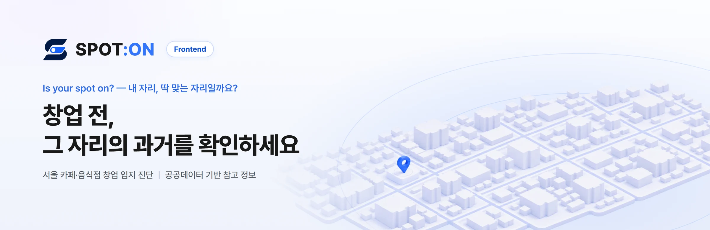
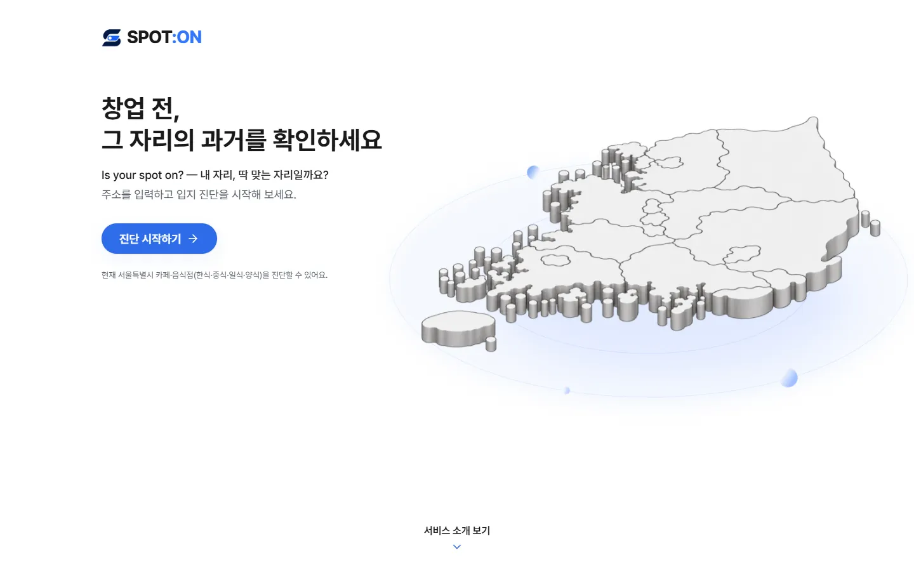
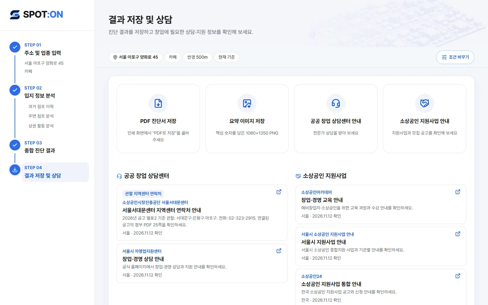
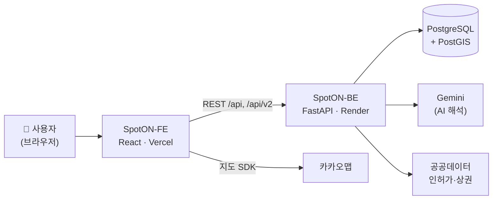

<div align="center">



계약하려는 주소 하나로 그 자리를 거쳐 간 점포의 이력과 주변 같은 업종의 생존 기록을 근거와 함께 보여주는<br>
**공공데이터 기반 창업 입지 진단 웹서비스**

[🌐 서비스 바로가기](https://spot-on-fe-two.vercel.app) · [💻 프론트엔드 저장소](https://github.com/sigoreu-jabeujong/SpotON-FE) · [⚙️ 백엔드 저장소](https://github.com/sigoreu-jabeujong/SpotON-BE) · [📚 문서 모음](docs/README.md)


</div>

---

## 목차

1. [프로젝트 소개](#1-프로젝트-소개)
2. [주요 기능](#2-주요-기능)
3. [화면 구성](#3-화면-구성)
4. [시스템 구성 · 접속 주소](#4-시스템-구성)
5. [기술 스택](#5-기술-스택)
6. [시작하기 · FE/BE 실행 방법](#6-시작하기)
7. [폴더 구조](#7-폴더-구조)
8. [문서](#8-문서)
9. [협업 규칙](#9-협업-규칙)
10. [사용한 공공데이터](#10-사용한-공공데이터)
11. [팀 소개](#11-팀-소개)
12. [유의사항](#12-유의사항)

---

## 1. 프로젝트 소개

| 항목 | 내용 |
|---|---|
| 서비스 | **Spot:ON(스팟온)** — 창업 입지(자리) 진단 공공서비스 |
| 대상 | 서울특별시에서 **카페·음식점**(한식·중식·일식·양식) 창업을 준비하는 **만 18세 이상 예비창업자** |
| 문제 | 계약 전에 "이 자리에 어떤 가게가 있었고, 주변 가게는 얼마나 버텼는지" 확인할 방법이 마땅치 않음 |
| 해결 | 인허가·상권 공공데이터로 **과거 점포 이력 · 주변 동일 업종 현황 · 참고지표 · AI 해석**을 한 화면 흐름으로 제공 |
| 원칙 | 자체 점수·등급 없이 **근거(출처·기준일·공간 단위)와 함께** 사실을 보여줌 |
| 소속 | 2026 청년 공공AX 서포터즈 · 팀 **시고르자브종** |

## 2. 주요 기능

| ID | 기능 | 설명 |
|---|---|---|
| F-01 | 주소·업종 입력 | 주소 검색·후보 선택, 카페/음식점 선택, 서울 밖 주소 차단 |
| F-02 | 과거 점포 이력 | 같은 건물을 거쳐 간 점포의 개업·폐업일, 영업 기간 |
| F-03 | 주변 동일 업종 지도 | 반경 안 같은 업종 점포를 카카오 지도에 영업 중/폐업으로 표시 |
| F-04 | 세부 필터 | 반경 300/500/1,000m, 음식점 세부 업종, 시설 규모 조건 |
| F-05 | 시점 조회 | 1·3·5년 전 등 과거 시점에 있던 점포가 지금도 영업 중인지 확인 |
| F-06 | 점포 변동·상권지표 | 최근 12개월 개업·폐업 수, 연도별 추이 차트 |
| F-07 | 정량지표 | 서울시 공식 지표와 Spot:ON 참고지표(폐업률·1·3주년 생존율·동종업체 수)를 영역을 나눠 표시 |
| F-08 | AI 해석·체크리스트 | 버튼을 누를 때만 서버가 검증한 해석과 계약 전 확인사항 제공 |
| F-09 | 결과 저장·공유 | PDF 진단서 저장 |
| F-10 | 공공 상담 연결 | 창업상담·소상공인 지원기관 링크, 다른 주소 재진단 |
| F-11 | 생활인구 공개자료 비교 | 내국인·장기/단기 외국인별 동일 공개 구성의 주야간 참고값과 관측일·제한 표시. 전체 인구·방문객 수와 구분 |
| F-12 | 위치 참고 매출 | 검색 위치와 상권의 공간 관계, 원자료 매출 금액·분기·출처 표시. 최신 참고자료와 분석기간 일치 조회 구분 |

### FE · BE 역할

| 구분 | 담당 기능 | 관련 파일·문서 |
|---|---|---|
| FE | 단계별 화면, 진단 조건 URL 유지, 지도·차트·필터, 상태 안내, PDF 저장 | [화면 경로](src/router.tsx), [API 호출](src/api/client.ts) |
| BE | 서울 주소 검색, 점포 이력·반경·과거 시점 조회, 지표 집계, 생활인구·위치 참고자료 응답 | [API 문서](https://spoton-be-free.onrender.com/docs) |
| BE · 데이터 | 인허가·상권·생활인구 원천 검증과 ETL, PostgreSQL/PostGIS 공간 조회, 출처·기준일 관리 | [BE 데이터 적재 안내](https://github.com/sigoreu-jabeujong/SpotON-BE/blob/develop/README.md) |
| BE · AI | 서버의 검증된 지표·근거를 바탕으로 Gemini 해석을 생성·검증해 반환 | [AI 계약](docs/ai-narrative.md) |

자료가 없거나 준비되지 않은 기능은 상태와 사유를 보여줘요. 코드에 기능이 있어도 운영 반영 여부는 [배포 안내](docs/deploy.md)와 연결된 실행 기록을 확인해 주세요.

## 3. 화면 구성

랜딩 → **STEP 01** 입력 → **STEP 02** 분석 → **STEP 03** 종합 진단 → **STEP 04** 저장·상담 순서로 진행해요.
화면 예시는 실제 공공데이터(기준일 2026.11.08)로 찍은 데스크톱 1440×900 화면이에요. 시연 순서는 [시연 대본](docs/demo.md)에 있어요.

| | |
|:---:|:---:|
|  |  |
| **랜딩** — 서비스 소개와 진단 시작 | **STEP 01 주소·업종 입력** |
|  |  |
| **STEP 02 입지 정보 분석** — 이력·지도·필터·상권 활동 | **STEP 03 종합 진단 결과** — 공식/참고 지표 분리 |
|  |  |
| **AI 해석** — 검증된 본문 + 계약 전 확인사항 | **STEP 04 결과 저장 및 상담** |

<details>
<summary><b>화면 경로 한눈에 보기</b></summary>

| 경로 | 단계 | 화면 |
|---|---|---|
| `/` | — | 랜딩 |
| `/diagnose` | STEP 01 | 주소·업종 입력 |
| `/result/analysis` | STEP 02 | 과거 점포 이력(`#history`) · 주변 점포 분석(`#nearby`) · 상권 활동(`#activity`) |
| `/result/summary` | STEP 03 | 종합 진단 결과 + AI 해석 |
| `/result/share` | STEP 04 | PDF 진단서 저장, 상담 연결 |
| `/result/report` | 인쇄 | 진단 조건·결과를 담은 인쇄용 보고서 |

진단 조건(주소·업종·반경·시점·필터)은 URL 쿼리에 담겨 있어 새로고침·링크 공유를 해도 그대로 유지돼요. AI 해석 본문은 공유 URL에 저장되지 않으며 버튼으로 별도 요청해요.

</details>

### 서비스 이용 방법

1. [서비스](https://spot-on-fe-two.vercel.app)에 접속해 **진단 시작**을 눌러요. 회원가입은 필요하지 않아요.
2. **STEP 01**에서 서울 주소를 검색하고 후보를 선택한 뒤 카페 또는 음식점 업종을 골라요. 서울 밖 주소는 분석하지 않아요.
3. **STEP 02**에서 같은 건물의 점포 이력과 주변 점포 지도를 확인해요. 반경·세부 업종·시설 규모 조건을 바꾸거나 과거 시점을 선택해 비교해요. 수치마다 출처·기준일·분모도 함께 확인해 주세요.
4. **STEP 03**에서 공식 지표와 Spot:ON 참고지표를 확인해요. **AI 해석 보기**를 누르면 현재 조건의 해석과 계약 전 확인사항을 요청해요. 실패 시 안내를 확인하고 다시 시도할 수 있어요.
5. **STEP 04**에서 PDF 진단서를 저장해요. PDF는 브라우저 인쇄 창에서 **PDF로 저장**을 선택하고, 필요한 경우 공공 상담기관 링크로 이동해요.

무료 BE가 절전 상태라면 첫 응답에 약 30초~1분이 걸릴 수 있어요. 오류가 계속되면 [문제 해결](#문제-해결)을 확인해 주세요.

## 4. 시스템 구성



### 접속 주소 · 저장소 URL

| 구분 | 주소 | 용도 |
|---|---|---|
| 운영 FE | [https://spot-on-fe-two.vercel.app](https://spot-on-fe-two.vercel.app) | 설치 없이 브라우저로 이용 |
| 운영 BE | [https://spoton-be-free.onrender.com](https://spoton-be-free.onrender.com) | API 기본 주소. 웹 화면은 FE에서 이용 |
| 운영 API 문서 | [Swagger UI](https://spoton-be-free.onrender.com/docs) | 요청 인자·응답 확인 |
| 운영 상태 | [health](https://spoton-be-free.onrender.com/api/health) · [ready](https://spoton-be-free.onrender.com/api/ready) | 프로세스 상태 / DB 준비 상태 |
| 로컬 FE | [http://localhost:5173](http://localhost:5173) | `npm run dev` 실행 후 접속 |
| 로컬 BE | [Swagger](http://localhost:8000/docs) · [health](http://localhost:8000/api/health) · [ready](http://localhost:8000/api/ready) | Uvicorn 실행 후 확인 |
| FE 저장소 | [sigoreu-jabeujong/SpotON-FE](https://github.com/sigoreu-jabeujong/SpotON-FE) | FE 소스·환경변수 예시·빌드 설정 |
| BE 저장소 | [sigoreu-jabeujong/SpotON-BE](https://github.com/sigoreu-jabeujong/SpotON-BE) | BE 소스·DB 구성·ETL·운영 문서 |

FE는 `main` 병합 시 Vercel에 자동 배포되고, BE는 Render에서 별도로 배포해요. health 성공만으로 DB·분석 데이터 준비를 판단하지 않아요.

- 모든 응답은 `{ data, meta, error }` 형식이고, `meta`에 출처·기준일·공간 단위가 담겨요 → [API 계약](docs/api-contract.md)
- **프론트에서는 지표를 계산하지 않아요.** 서버가 준 값을 형식만 바꿔 보여줘요 → [화면 표시 원칙](docs/display-rules.md)

## 5. 기술 스택

| 구분 | 사용 |
|---|---|
| 프레임워크 | React 19, TypeScript, Vite |
| 스타일 | Tailwind CSS v4 (디자인 토큰: `src/index.css`의 `@theme`) |
| 라우팅 · 서버 데이터 | React Router (화면별 지연 로딩) · TanStack Query |
| 지도 · 차트 | 카카오맵 JavaScript SDK · recharts |
| 저장 | 브라우저 인쇄(PDF) |
| 아이콘 · 글꼴 | lucide-react · Pretendard |
| FE 품질 | ESLint, Prettier, Vitest, GitHub Actions CI |
| BE 프레임워크 | Python 3.11, FastAPI, Uvicorn, Pydantic |
| DB · 공간 조회 | PostgreSQL, PostGIS, SQLAlchemy, GeoAlchemy2, psycopg |
| DB 변경 · 원천 적재 | Alembic, Python ETL, pyproj |
| AI | Google Gemini API (서버에서만 호출) |
| BE 품질 · 의존성 | pytest, Ruff, mypy, uv · uv.lock |
| 배포 | FE: Vercel / BE: Render · Docker |

## 6. 시작하기

### 실행 파일 · 준비 사항

브라우저로 이용하는 웹서비스라 별도 `.exe` 설치 파일은 없어요. 실행 소스·설정 파일과 URL을 각 저장소에 함께 등록하고 아래 명령으로 실행·빌드해요.

| 구분 | 등록된 파일 | 실행·결과물 |
|---|---|---|
| FE 진입점 · 의존성 | [index.html](index.html), [src/main.tsx](src/main.tsx), [package.json](package.json), [package-lock.json](package-lock.json) | `npm run dev` / `npm run build` → `dist/` |
| FE 환경 · 배포 | [.env.example](.env.example), [.env.production.example](.env.production.example), [vercel.json](vercel.json), [빌드 스크립트](scripts/build-vercel.mjs) | 환경별 설정과 Vercel 배포 |
| BE 진입점 · 의존성 | [app/main.py](https://github.com/sigoreu-jabeujong/SpotON-BE/blob/develop/app/main.py), [pyproject.toml](https://github.com/sigoreu-jabeujong/SpotON-BE/blob/develop/pyproject.toml), [uv.lock](https://github.com/sigoreu-jabeujong/SpotON-BE/blob/develop/uv.lock) | Uvicorn으로 API 실행 |
| BE 환경 · DB · 배포 | [.env.example](https://github.com/sigoreu-jabeujong/SpotON-BE/blob/develop/.env.example), [compose.yaml](https://github.com/sigoreu-jabeujong/SpotON-BE/blob/develop/compose.yaml), [Dockerfile](https://github.com/sigoreu-jabeujong/SpotON-BE/blob/develop/Dockerfile) | 로컬 DB 컨테이너 / BE 배포 이미지 |

`dist/`와 가상환경은 명령으로 생성해요. 실제 `.env`, 인증키, 비밀번호와 원천 데이터는 커밋하지 않아요.

| 실행 방식 | 필요한 환경 | 용도 |
|---|---|---|
| 운영 서비스 이용 | 웹 브라우저 | 설치 없이 실제 서비스 확인 |
| FE 목업 실행 | Node.js **24.x 권장** (최소 22.22.0), npm, Git | BE·DB 없이 예시 응답으로 화면 확인 |
| FE + 운영 BE | 위 FE 환경, 카카오맵 JavaScript 키(지도 확인 시) | 운영 API와 로컬 FE 연결 |
| FE + 로컬 BE | 위 FE 환경 + Python **3.11.x**, uv **0.13.7**, Docker Desktop(Linux engine) | 로컬 API·PostgreSQL/PostGIS 연결 |

### 6-1. FE 실행

```bash
# 1. 저장소 받기
git clone https://github.com/sigoreu-jabeujong/SpotON-FE.git
cd SpotON-FE

# 2. 패키지 설치
npm ci

# 3. 환경변수 파일 만들기 (.env는 커밋하지 않아요)
cp .env.example .env
# 아래 실행 방식별 설정표에 따라 .env 값을 편집한 뒤 실행해요

# 4. 개발 서버 실행 → http://localhost:5173
npm run dev
```

Windows PowerShell에서는 `Copy-Item .env.example .env`로 복사해요. 기존 `.env`가 있으면 복사하지 말고 필요한 항목만 수정하세요.

| `.env` 설정 | FE 목업 | 운영 BE 연결 | 로컬 BE 연결 |
|---|---|---|---|
| `VITE_API_BASE_URL` | `http://localhost:8000` (호출하지 않음) | `https://spoton-be-free.onrender.com` | `http://localhost:8000` |
| `VITE_USE_MOCK` | `true` | `false` | `false` |
| `VITE_REAL_API_PATHS` | 비움 | 비움 | 비움 |
| `VITE_ANALYSIS_API_VERSION` | `v1` | `v2` | 기본 `v1`, v2 데이터 준비 시 `v2` |

- 목업은 `src/api/mocks/`의 예시 응답이며 실제 공공데이터 조회 결과가 아니에요.
- 운영 BE 연결에는 BE `CORS_ORIGINS`에 로컬 FE origin이 허용돼 있어야 해요. 허용되지 않았다면 로컬 BE 또는 목업으로 확인해요.
- 지도까지 확인하려면 `VITE_KAKAO_JS_KEY`를 추가하고 카카오 개발자 콘솔에 실제 FE origin을 등록해요. 키가 없으면 지도 영역에 안내가 표시돼요.
- Vite가 다른 포트로 실행되면 터미널의 실제 접속 주소를 확인하고 BE CORS·카카오 허용 도메인에도 같은 origin을 사용해요.
- `.env`를 바꾼 뒤에는 개발 서버를 다시 시작해야 반영돼요.

### 6-2. BE 실행 · 로컬 DB 준비

FE와 같은 상위 폴더의 **새 터미널**에서 실행해요. 아래 명령은 Windows PowerShell 기준이에요.

```powershell
git clone https://github.com/sigoreu-jabeujong/SpotON-BE.git
Set-Location SpotON-BE
py -3.11 -m pip install uv==0.13.7
# Windows 한글 경로의 editable 설치 인코딩 오류 방지
$env:UV_NO_EDITABLE = "1"
uv sync --locked --extra dev

# 처음 설정할 때만 복사. 기존 .env는 유지해요
Copy-Item .env.example .env
```

BE `.env`에서 아래 값을 설정해요. FE JavaScript 키와 BE REST API 키는 서로 다른 키예요.

| 변수 | 설정·필요한 기능 |
|---|---|
| `APP_ENV` | 로컬 실행은 `local` |
| `CORS_ORIGINS` | 실제 FE origin. 기본 `http://localhost:5173`, 여러 개는 쉼표로 구분 |
| `SPOTON_DB_ADMIN_PASSWORD` · `SPOTON_DB_PASSWORD` | 로컬 DB 초기화·앱 계정 비밀번호. 서로 다른 값 사용 |
| `DATABASE_URL` | `postgresql+psycopg://spoton_app:<앱 비밀번호>@127.0.0.1:5432/spoton_dev`. 비밀번호 특수문자는 URL 인코딩 |
| `DATABASE_EXPECTED_REVISION` | BE `.env.example`의 현재 revision과 적용된 migration head를 일치시킴 |
| `KAKAO_REST_API_KEY` | 서울 주소 검색에 필요한 서버 전용 키 |
| `LLM_PROVIDER` · `LLM_MODEL` · `LLM_API_KEY` | AI 해석 사용 시 설정. 모델 기본값·한도는 BE `.env.example` 참고 |
| `DATA_GO_KR_SERVICE_KEY` | 공공데이터 원천 수집·ETL을 직접 수행할 때 필요 |
| `JUSO_SEARCH_KEY` · `JUSO_COORD_KEY` | 도로명주소 관련 기능을 구성할 때 사용 |

```powershell
# Docker Desktop 실행 후 BE 저장소 루트에서 실행
docker compose config --quiet
docker compose up -d --wait db

# 로컬 개발 DB 설정 확인 후 테이블·인덱스 생성
uv run --locked --extra dev alembic upgrade head
uv run --locked --extra dev alembic current

# API 서버 → http://localhost:8000/docs
uv run --locked --extra dev uvicorn app.main:app --reload --no-access-log
```

**DB 생성·migration만으로 분석 데이터가 채워지지는 않아요.** 실제 조회에는 BE README의 원천 검증·ETL 절차에 따른 데이터 적재가 필요해요. [BE 전체 설정·적재 안내](https://github.com/sigoreu-jabeujong/SpotON-BE/blob/develop/README.md)를 확인해 주세요.

DB 없이 프로세스만 확인하려면 의존성 설치 후 위 Uvicorn 명령만 실행해도 돼요. `/api/health`는 동작하지만 DB 기반 분석이 준비됐다는 뜻은 아니에요. DB 준비 후 `/api/ready`와 실제 분석 API도 확인해요.

### 6-3. FE · BE 연결 확인과 종료

1. BE를 실행하고 [로컬 health](http://localhost:8000/api/health)와 [Swagger](http://localhost:8000/docs)를 열어요. health 정상 응답은 `{"data":{"status":"ok"},"meta":{},"error":null}`이에요.
2. 다른 터미널에서 FE `.env`를 `VITE_USE_MOCK=false`, `VITE_API_BASE_URL=http://localhost:8000`으로 설정하고 FE를 실행해요.
3. 서울 주소 검색 → 후보 선택 → STEP 02 이력·지도·지표 → STEP 03 AI 해석 → STEP 04 PDF 저장을 확인해요. AI는 LLM 키가 준비된 경우에 확인해요.
4. 필터·시점 변경 후 새로고침해도 조건이 유지되는지, 출처·기준일과 결측 사유가 표시되는지 확인해요.
5. 종료 시 각 터미널에서 `Ctrl+C`를 누르고 BE 폴더에서 `docker compose stop db`로 DB를 중단해요. 데이터는 볼륨에 보존돼요.

### 6-4. FE 빌드 · 결과물 실행

```bash
# 파일이 없을 때 복사한 뒤 실제 BE 주소·공개 지도 키를 설정해요
cp .env.production.example .env.production
# 실제 API 배포: VITE_USE_MOCK=false, VITE_REAL_API_PATHS는 비움
npm run build
# dist/ 결과물 미리보기
npm run preview -- --port 5180
```

미리보기 주소는 `http://localhost:5180`이에요. API·지도를 확인하려면 이 origin도 BE CORS와 카카오 설정에 등록해요. `dist/`는 정적 호스팅용 결과물로 HTTP 서버에서 제공해요. 운영과 동일한 v2 분석을 빌드하려면 `.env.production`에도 `VITE_ANALYSIS_API_VERSION=v2`를 설정해요.

### 환경변수

| 이름 | 설명 | 예시 |
|---|---|---|
| `VITE_API_BASE_URL` | 백엔드 서버 주소 (`/api`는 코드가 붙여요) | `http://localhost:8000` |
| `VITE_USE_MOCK` | `true`면 백엔드 없이 목업 응답 사용 | `true` / `false` |
| `VITE_REAL_API_PATHS` | 목업 모드에서도 실제 백엔드로 보낼 경로 (쉼표 구분) | `/geocode` |
| `VITE_KAKAO_JS_KEY` | 카카오맵 JavaScript 키. 콘솔에 허용 도메인 등록 필수, 없으면 지도 자리에 안내만 표시 | — |
| `VITE_ANALYSIS_API_VERSION` | 분석 API 버전. 기본 `v1`, 운영 배포는 `v2`. [분석 API 설정](src/config/analysisVersion.ts) 참고 | `v1` |

> ⚠️ `VITE_`로 시작하는 값은 브라우저에 그대로 보여요. 카카오맵 JavaScript 키(공개용) 외의 비밀값은 절대 넣지 마세요.

### 명령어

| 명령어 | 설명 |
|---|---|
| `npm run dev` | 개발 서버 실행 |
| `npm run build` | 타입 검사 + 배포용 빌드 |
| `npm run preview -- --port 5180` | `dist/` 빌드 결과 확인 |
| `npm run test` | Vitest 단위 테스트 + 배포 프로필 검사 |
| `npm run lint` | 코드 검사 (ESLint) |
| `npm run format` / `npm run format:check` | 코드 자동 정리 / 정리 상태 확인 (Prettier) |
| `uv run --locked --extra dev pytest` | BE 기본 단위 검사 (BE 폴더에서 실행, 실제 DB 통합 검사는 별도) |

PR과 `develop` push마다 GitHub Actions가 **설치 → 린트 → 단위 테스트 → 빌드**를 실행해요. 배포 방법은 [배포 안내](docs/deploy.md)에 있어요.

### 문제 해결

| 증상 | 확인할 내용 |
|---|---|
| 첫 접속이 느림 | 무료 BE 절전 해제 대기. 약 30초~1분 후 재확인 |
| API 연결·CORS 오류 | BE 실행 여부, API 주소의 `/api` 중복 여부, `CORS_ORIGINS`의 FE origin·포트 확인 |
| health는 정상인데 분석 실패 | DB 연결·migration·원천 데이터 적재 여부 확인 |
| 주소 검색 실패 | BE REST API 키, 서울 주소 여부, 외부 API 상태 확인 |
| 지도만 보이지 않음 | FE JavaScript 키와 카카오 허용 도메인 확인 |
| AI 해석 불가 | BE LLM 키·모델·한도, 표본 부족·검증 실패 안내 확인 |
| v2 조회 실패 | FE API 버전과 BE 스키마·분석 데이터 준비 상태 확인 |
| 환경변수 변경 미반영 | 개발 서버 재시작 또는 배포 재빌드 여부 확인 |

<details>
<summary><b>목업 모드에서 상황별로 확인하는 입력값</b></summary>

| 입력 | 결과 |
|---|---|
| 주소에 `없는` | 주소를 찾지 못함 (404) |
| 주소에 서울 외 지역명 (예: `경기도`) | 서울 외 주소 (422) |
| 주소에 `여러` | 주소 후보 목록 |
| 반경 300m | 표본 부족(판단 보류), AI 해석 검증 실패 |
| 반경 1,000m | AI 해석 실패 (503) |
| 기준 시점 2025년 이전 / 2021년 이전 | 추정매출 / 생활인구 "자료 없음" |
| 위도 `37.51` / `37.5` / 그 밖 | 상권 안 / 상권 밖 / 상권 확인 중 |
| 건물 키(`bk`)에 `missing` / `empty` / `error` | 이력 결측 / 0건 / 오류 |
| `bk`나 주소에 `dup` | 같은 관리번호·다른 원천 점포 |
| `bk`나 주소에 `pending` | 추정매출·생활인구 "자료 확인 중" |

</details>

## 7. 폴더 구조

```text
SpotON-FE/
├── .github/workflows/     # CI (린트 → 테스트 → 빌드)
├── docs/                  # 팀 문서 (API 계약, 화면 요구사항, 표시 원칙, 결정 사항 등)
│   └── images/            # README 화면 캡처
├── public/                # 파비콘, OG 이미지 등 정적 파일
├── scripts/               # Vercel 배포 환경별 빌드 스크립트
├── src/
│   ├── pages/             # 화면 단위 컴포넌트 (라우트 1개 = 파일 1개)
│   ├── components/
│   │   ├── landing/       # 랜딩 소개 섹션
│   │   ├── input/         # STEP 01 주소 검색·업종 선택
│   │   ├── analysis/      # STEP 02 이력·주변 점포·상권 활동·필터
│   │   ├── map/           # 카카오 지도, 마커 묶음
│   │   ├── summary/       # STEP 03 지표 카드, AI 해석
│   │   ├── share/         # STEP 04 PDF 진단서·상담 연결
│   │   ├── layout/        # 헤더·사이드바·진단 조건 바·푸터
│   │   └── common/        # 공통 UI (배지, 안내 상자, 오류 경계 등)
│   ├── api/               # 백엔드 호출 함수 (client.ts 공통 래퍼)
│   │   └── mocks/         # 목업 응답
│   ├── hooks/             # 커스텀 훅 (useDiagnosisQuery: 진단 조건을 URL에 유지)
│   ├── types/             # API 응답 등 공통 타입
│   ├── constants/         # 진단 조건, 상태 라벨, 화면 문구, 경로
│   ├── utils/             # 순수 함수 (날짜·숫자 형식, 점포 식별 — 지표 계산은 하지 않음)
│   ├── config/            # 분석 API 버전 설정
│   ├── test/              # 테스트 공용 데이터
│   ├── router.tsx         # 화면 경로 정의
│   └── main.tsx           # 앱 시작점
├── CLAUDE.md              # 개발 규칙
├── vercel.json            # Vercel 설정 (새로고침 대응)
└── package.json
```

## 8. 문서

| 문서 | 내용 |
|---|---|
| [문서 안내](docs/README.md) | 문서 목록과 기준 우선순위 |
| [API 계약](docs/api-contract.md) | FE 관점 API 요청·응답 요약 |
| [화면 요구사항](docs/screens.md) | 화면별 기능과 상태 처리 |
| [화면 표시 원칙](docs/display-rules.md) | 출처·기준일·상태 라벨, 공식/참고 영역 분리 |
| [AI 해석](docs/ai-narrative.md) | AI 문단 계약과 화면 구성 |
| [생활인구 공개자료 비교](docs/population-reference.md) · [AI 연결](docs/population-ai.md) | 원천별 부분 공개자료 비교, 관측일·제한 표시 |
| [BE README](https://github.com/sigoreu-jabeujong/SpotON-BE/blob/develop/README.md) | BE 실행·DB·ETL·검증 절차 |
| [브랜드·체인 v2](docs/brand-chain-v2.md) · [운영 전환](docs/production-chain-v2.md) | v2 도입 당시 계약·운영 전환 이력 (브랜드 기능은 이후 제거) |
| [브랜드 기능 제거](docs/remove-brand-feature.md) | 현재 요청에서 브랜드·가맹 조건을 사용하지 않는 기준 |
| [결정 사항](docs/decisions.md) | 팀 결정·미결 사항 기록 |
| [접근성](docs/accessibility.md) | 접근성 점검 결과 |
| [배포](docs/deploy.md) | Vercel 배포와 환경변수 |
| [시연 대본](docs/demo.md) | 발표용 시연 순서 |
| [개발 규칙](CLAUDE.md) | 코딩·Git 규칙, 절대 하지 말 것 |

## 9. 협업 규칙

| 항목 | 규칙 |
|---|---|
| 브랜치 | `main`(최종) ← `develop`(통합) ← `feat/`, `fix/`, `docs/`, `chore/` |
| 작업 단위 | 기능 하나 = 브랜치 하나 = PR 하나 (`develop` 대상), `main`·`develop` 직접 push 금지 |
| 커밋 | `타입: 내용` — `feat` `fix` `refactor` `perf` `docs` `style` `chore` |
| PR 전 확인 | `lint` · `format:check` · `build` · `test` 모두 통과 |
| 머지 | merge commit (커밋 기록 보존) |

## 10. 사용한 공공데이터

화면에 표시되는 출처 번호(R번호)와 같아요. 전체 표는 [화면 표시 원칙 7장](docs/display-rules.md#7-출처-번호-표)에 있어요.

| 번호 | 데이터 | 제공 |
|---|---|---|
| R5 · R6 | [일반음식점](https://www.data.go.kr/data/15154916/openapi.do) · [휴게음식점](https://www.data.go.kr/data/15154921/openapi.do) 인허가 | 행정안전부 |
| R1 · R11 | [서울시 상권분석서비스](https://golmok.seoul.go.kr/stateDistrict.do) · [창업위험도 산정 방식](https://golmok.seoul.go.kr/images/seoul_info.pdf) | 서울신용보증재단 |
| R2 · R15 | [점포-상권](https://data.seoul.go.kr/dataList/OA-15577/F/1/datasetView.do) · [영역-상권](https://data.seoul.go.kr/dataList/OA-15560/S/1/datasetView.do) | 서울 열린데이터광장 |
| R3 · R4 · R16 | [추정매출-상권](https://data.seoul.go.kr/dataList/OA-15572/S/1/datasetView.do) · [생활인구 250m 격자](https://data.seoul.go.kr/dataList/OA-22784/S/1/datasetView.do) · [상권변화지표](https://data.seoul.go.kr/dataList/OA-15576/S/1/datasetView.do) (조건부) | 서울 열린데이터광장 |
| R9 | [가맹정보](https://www.data.go.kr/data/15143693/openapi.do) (과거 브랜드·체인 추정 기능의 출처, 현재 기능 제거) | 공정거래위원회 |
| R19 | [주소](https://www.data.go.kr/data/15057017/openapi.do) · [좌표](https://www.data.go.kr/data/15056663/openapi.do) API | 행정안전부 |
| R8 | [카카오 로컬](https://developers.kakao.com/docs/latest/ko/local/dev-guide) · [지도](https://apis.map.kakao.com) | 카카오 |
| R17 | 창업상담·소상공인 지원기관 링크 | 서울시 자영업지원센터 외 |
| R18 | AI 해석 문장 구성 | Google Gemini API |

## 11. 팀 소개

| 이름 | 역할 | 담당 |
|---|---|---|
| 권민수 | 팀장 · PM | 기획 총괄, 일정 관리 |
| 윤희은 | UI/UX | 화면 디자인 |
| 류민지 | Frontend | 웹 화면 전체 개발·배포 |
| 최호림 | Backend | 서버·DB·API, 배포 |
| 김승은 | Backend | AI 해석·데이터 |

## 12. 유의사항

- Spot:ON의 결과는 공공데이터 기반 **참고 정보**예요. 창업의 **성공·실패를 판정하지 않으며**, 사업주의 역량은 반영하지 않아요.
- **폐업은 행정상 신고 기록 기준**이라 실제 영업 종료 시점과 다를 수 있어요.
- 현재 운영 화면에서는 브랜드·가맹 분류와 필터를 제공하지 않아요. 과거 도입 문서는 변경 이력으로 확인해 주세요.
- AI 해석은 서버가 계산·검증한 지표만으로 만든 참고 문장이며, 전문적인 조언을 대신하지 않아요.
- 회원가입 없이 이용하며 개인정보를 저장하지 않아요.
- 생활인구 공개자료 비교는 원천별 동일 공개 구성의 참고값이에요. 전체 인구·고유 방문객 수를 뜻하지 않으며 비공개·누락을 0으로 바꾸지 않아요.
