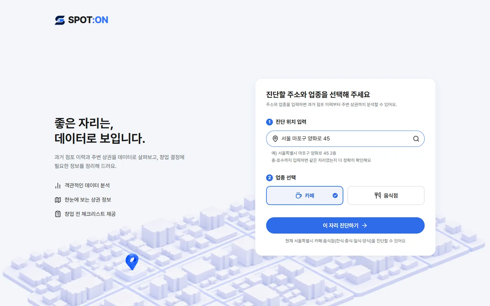
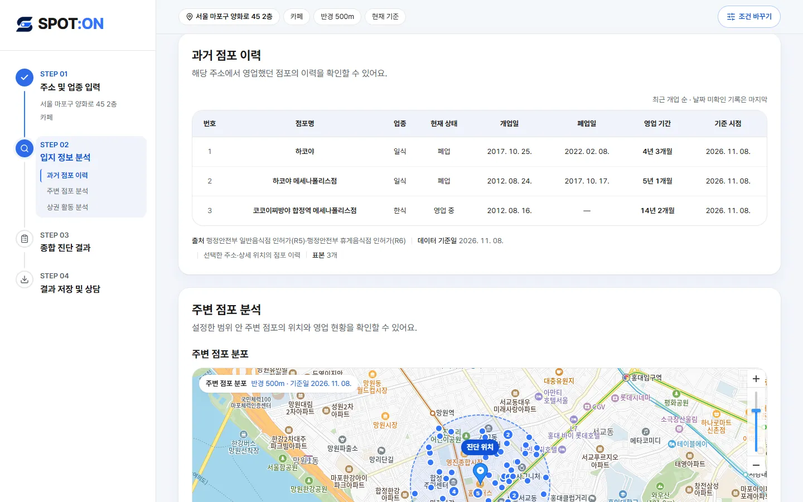
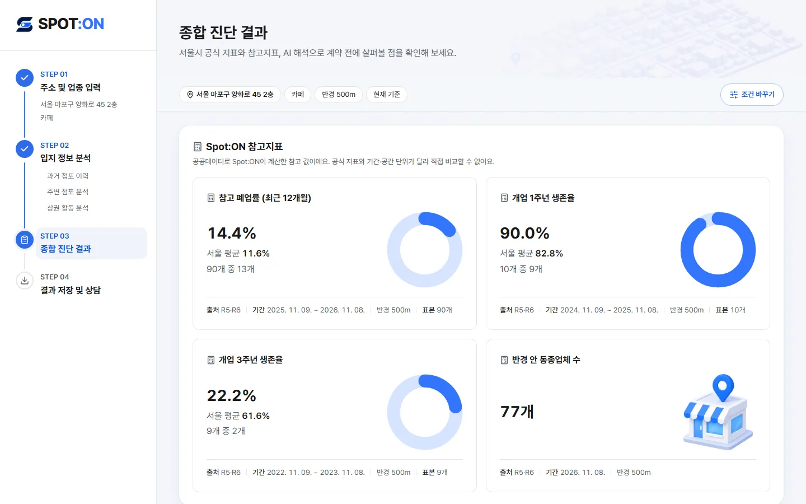
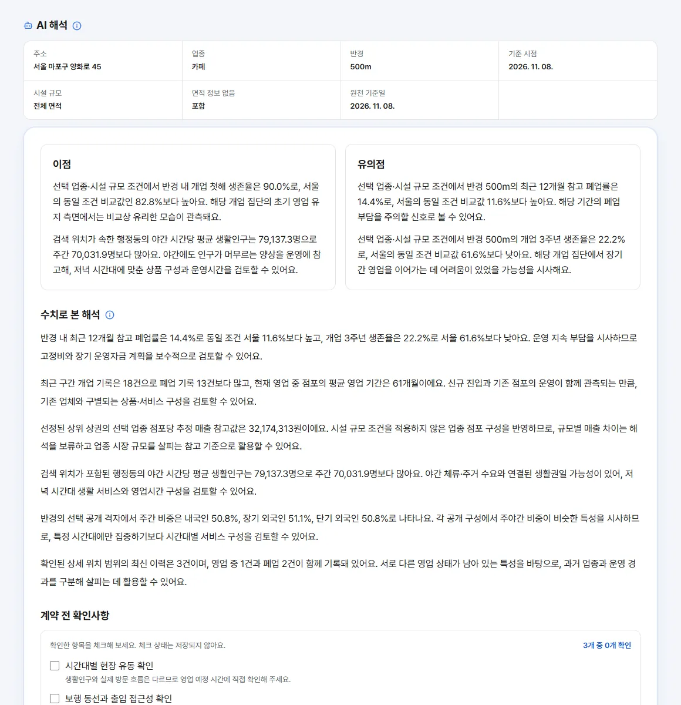
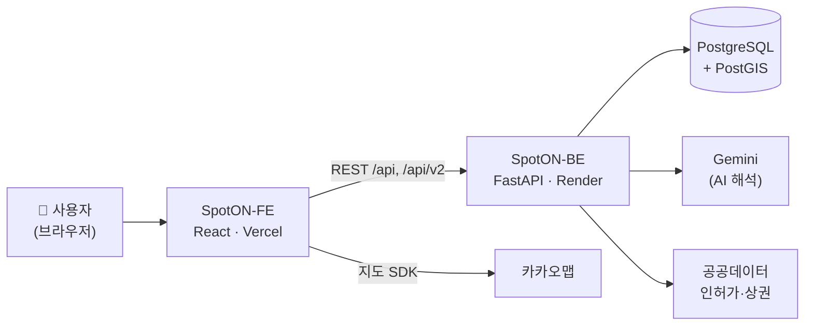

<div align="center">


계약하려는 주소 하나로 그 자리를 거쳐 간 점포의 이력과 주변 같은 업종의 생존 기록을 근거와 함께 보여주는<br>
**공공데이터 기반 창업 입지 진단 웹서비스**

[🌐 서비스 바로가기](https://spot-on-fe.vercel.app) · [⚙️ 백엔드 저장소](https://github.com/sigoreu-jabeujong/SpotON-BE) · [📚 문서 모음](docs/README.md)


</div>

---

## 목차

1. [프로젝트 소개](#1-프로젝트-소개)
2. [주요 기능](#2-주요-기능)
3. [화면 구성](#3-화면-구성)
4. [시스템 구성](#4-시스템-구성)
5. [기술 스택](#5-기술-스택)
6. [시작하기](#6-시작하기)
7. [폴더 구조](#7-폴더-구조)
8. [문서](#8-문서)
9. [협업 규칙](#9-협업-규칙)
10. [사용한 공공데이터](#10-사용한-공공데이터)
11. [팀 소개](#11-팀-소개)
12. [유의사항](#12-유의사항)

---

## 1. 프로젝트 소개

| 항목 | 내용 |
|---|---|
| 서비스 | **Spot:ON(스팟온)** — 창업 입지(자리) 진단 공공서비스 |
| 대상 | 서울특별시에서 **카페·음식점**(한식·중식·일식·양식) 창업을 준비하는 **만 18세 이상 예비창업자** |
| 문제 | 계약 전에 "이 자리에 어떤 가게가 있었고, 주변 가게는 얼마나 버텼는지" 확인할 방법이 마땅치 않음 |
| 해결 | 인허가·상권 공공데이터로 **과거 점포 이력 · 주변 동일 업종 현황 · 참고지표 · AI 해석**을 한 화면 흐름으로 제공 |
| 원칙 | 자체 점수·등급 없이 **근거(출처·기준일·공간 단위)와 함께** 사실을 보여줌 |
| 소속 | 2026 청년 공공AX 서포터즈 · 팀 **시고르자브종** |

## 2. 주요 기능

| ID | 기능 | 설명 |
|---|---|---|
| F-01 | 주소·업종 입력 | 주소 검색·후보 선택, 카페/음식점 선택, 서울 밖 주소 차단 |
| F-02 | 과거 점포 이력 | 같은 건물을 거쳐 간 점포의 개업·폐업일, 영업 기간, 브랜드·체인(추정) |
| F-03 | 주변 동일 업종 지도 | 반경 안 같은 업종 점포를 카카오 지도에 영업 중/폐업으로 표시 |
| F-04 | 세부 필터 | 반경 300/500/1,000m, 음식점 세부 업종, 시설 규모, 브랜드·체인 조건 |
| F-05 | 시점 조회 | 1·3·5년 전 등 과거 시점에 있던 점포가 지금도 영업 중인지 확인 |
| F-06 | 점포 변동·상권지표 | 최근 12개월 개업·폐업 수, 연도별 추이 차트 |
| F-07 | 정량지표 | 서울시 공식 지표와 Spot:ON 참고지표(폐업률·1·3주년 생존율·동종업체 수)를 영역을 나눠 표시 |
| F-08 | AI 해석·체크리스트 | 버튼을 누를 때만 서버가 검증한 4문단 해석과 계약 전 확인사항 제공 |
| F-09 | 결과 저장·공유 | PDF 진단서, 1080×1350 요약 이미지 저장 |
| F-10 | 공공 상담 연결 | 창업상담·소상공인 지원기관 링크, 다른 주소 재진단 |

## 3. 화면 구성

랜딩 → **STEP 01** 입력 → **STEP 02** 분석 → **STEP 03** 종합 진단 → **STEP 04** 저장·상담 순서로 진행해요.
화면 예시는 실제 공공데이터(기준일 2026.11.08)로 찍은 데스크톱 1440×900 화면이에요. 시연 순서는 [시연 대본](docs/demo.md)에 있어요.

| | |
|:---:|:---:|
|  |  |
| **랜딩** — 서비스 소개와 진단 시작 | **STEP 01 주소·업종 입력** |
|  |  |
| **STEP 02 입지 정보 분석** — 이력·지도·필터·상권 활동 | **STEP 03 종합 진단 결과** — 공식/참고 지표 분리 |
|  |  |
| **AI 해석** — 4문단 본문 + 계약 전 확인사항 | **STEP 04 결과 저장 및 상담** |

<details>
<summary><b>화면 경로 한눈에 보기</b></summary>

| 경로 | 단계 | 화면 |
|---|---|---|
| `/` | — | 랜딩 |
| `/diagnose` | STEP 01 | 주소·업종 입력 |
| `/result/analysis` | STEP 02 | 과거 점포 이력(`#history`) · 주변 점포 분석(`#nearby`) · 상권 활동(`#activity`) |
| `/result/summary` | STEP 03 | 종합 진단 결과 + AI 해석 |
| `/result/share` | STEP 04 | PDF 진단서·요약 이미지 저장, 상담 연결 |

진단 조건(주소·업종·반경·시점·필터)은 URL 쿼리에 담겨 있어 새로고침·링크 공유를 해도 그대로 유지돼요.

</details>

## 4. 시스템 구성



| 구분 | 주소 | 비고 |
|---|---|---|
| 프론트엔드 | https://spot-on-fe.vercel.app | `main`에 머지되면 자동 배포 |
| 백엔드 | https://spoton-be-free.onrender.com | 무료 서버라 쉬고 있으면 첫 접속에 약 30초 걸려요 |

- 모든 응답은 `{ data, meta, error }` 형식이고, `meta`에 출처·기준일·공간 단위가 담겨요 → [API 계약](docs/api-contract.md)
- **프론트에서는 지표를 계산하지 않아요.** 서버가 준 값을 형식만 바꿔 보여줘요 → [화면 표시 원칙](docs/display-rules.md)

## 5. 기술 스택

| 구분 | 사용 |
|---|---|
| 프레임워크 | React 19, TypeScript, Vite |
| 스타일 | Tailwind CSS v4 (디자인 토큰: `src/index.css`의 `@theme`) |
| 라우팅 · 서버 데이터 | React Router (화면별 지연 로딩) · TanStack Query |
| 지도 · 차트 | 카카오맵 JavaScript SDK · recharts |
| 저장 | 브라우저 인쇄(PDF) · html2canvas(요약 이미지) |
| 아이콘 · 글꼴 | lucide-react · Pretendard |
| 품질 | ESLint, Prettier, Vitest(단위 테스트 159개), GitHub Actions CI |
| 배포 | Vercel |

## 6. 시작하기

> Node.js 20 이상, npm이 필요해요.

```bash
# 1. 저장소 받기
git clone https://github.com/sigoreu-jabeujong/SpotON-FE.git
cd SpotON-FE

# 2. 패키지 설치
npm install

# 3. 환경변수 파일 만들기 (.env는 커밋하지 않아요)
cp .env.example .env

# 4. 개발 서버 실행 → http://localhost:5173
npm run dev
```

> 백엔드 없이 화면만 보려면 `.env`에 `VITE_USE_MOCK=true`를 넣으세요. 예시 응답으로 모든 화면이 동작해요.
> `.env`를 바꾼 뒤에는 개발 서버를 다시 켜야 반영돼요.

### 환경변수

| 이름 | 설명 | 예시 |
|---|---|---|
| `VITE_API_BASE_URL` | 백엔드 서버 주소 (`/api`는 코드가 붙여요) | `http://localhost:8000` |
| `VITE_USE_MOCK` | `true`면 백엔드 없이 목업 응답 사용 | `true` / `false` |
| `VITE_REAL_API_PATHS` | 목업 모드에서도 실제 백엔드로 보낼 경로 (쉼표 구분) | `/geocode` |
| `VITE_KAKAO_JS_KEY` | 카카오맵 JavaScript 키. 콘솔에 허용 도메인 등록 필수, 없으면 지도 자리에 안내만 표시 | — |
| `VITE_ANALYSIS_API_VERSION` | 분석 API 버전. 기본 `v1`, 운영 배포는 `v2` → [브랜드·체인 v2](docs/brand-chain-v2.md) | `v1` |

> ⚠️ `VITE_`로 시작하는 값은 브라우저에 그대로 보여요. 카카오맵 JavaScript 키(공개용) 외의 비밀값은 절대 넣지 마세요.

### 명령어

| 명령어 | 설명 |
|---|---|
| `npm run dev` | 개발 서버 실행 |
| `npm run build` | 타입 검사 + 배포용 빌드 |
| `npm run test` | 단위 테스트 (Vitest) |
| `npm run lint` | 코드 검사 (ESLint) |
| `npm run format` / `format:check` | 코드 자동 정리 / 정리 상태 확인 (Prettier) |

PR과 `develop` push마다 GitHub Actions가 **설치 → 린트 → 단위 테스트 → 빌드**를 실행해요. 배포 방법은 [배포 안내](docs/deploy.md)에 있어요.

<details>
<summary><b>목업 모드에서 상황별로 확인하는 입력값</b></summary>

| 입력 | 결과 |
|---|---|
| 주소에 `없는` | 주소를 찾지 못함 (404) |
| 주소에 서울 외 지역명 (예: `경기도`) | 서울 외 주소 (422) |
| 주소에 `여러` | 주소 후보 목록 |
| 반경 300m | 표본 부족(판단 보류), AI 해석 검증 실패 |
| 반경 1,000m | AI 해석 실패 (503) |
| 기준 시점 2025년 이전 / 2021년 이전 | 추정매출 / 생활인구 "자료 없음" |
| 위도 `37.51` / `37.5` / 그 밖 | 상권 안 / 상권 밖 / 상권 확인 중 |
| 건물 키(`bk`)에 `missing` / `empty` / `error` | 이력 결측 / 0건 / 오류 |
| `bk`나 주소에 `dup` | 같은 관리번호·다른 원천 점포 |
| `bk`나 주소에 `pending` | 추정매출·생활인구 "자료 확인 중" |

</details>

## 7. 폴더 구조

```text
SpotON-FE/
├── .github/workflows/     # CI (린트 → 테스트 → 빌드)
├── docs/                  # 팀 문서 (API 계약, 화면 요구사항, 표시 원칙, 결정 사항 등)
│   └── images/            # README 화면 캡처
├── public/                # 파비콘, OG 이미지 등 정적 파일
├── scripts/               # Vercel 배포 환경별 빌드 스크립트
├── src/
│   ├── pages/             # 화면 단위 컴포넌트 (라우트 1개 = 파일 1개)
│   ├── components/
│   │   ├── landing/       # 랜딩 소개 섹션
│   │   ├── input/         # STEP 01 주소 검색·업종 선택
│   │   ├── analysis/      # STEP 02 이력·주변 점포·상권 활동·필터
│   │   ├── map/           # 카카오 지도, 마커 묶음
│   │   ├── summary/       # STEP 03 지표 카드, AI 해석
│   │   ├── share/         # STEP 04 PDF 진단서, 요약 이미지
│   │   ├── layout/        # 헤더·사이드바·진단 조건 바·푸터
│   │   └── common/        # 공통 UI (배지, 안내 상자, 오류 경계 등)
│   ├── api/               # 백엔드 호출 함수 (client.ts 공통 래퍼)
│   │   └── mocks/         # 목업 응답
│   ├── hooks/             # 커스텀 훅 (useDiagnosisQuery: 진단 조건을 URL에 유지)
│   ├── types/             # API 응답 등 공통 타입
│   ├── constants/         # 진단 조건, 상태 라벨, 화면 문구, 경로
│   ├── utils/             # 순수 함수 (날짜·숫자 형식, 점포 식별 — 지표 계산은 하지 않음)
│   ├── config/            # 분석 API 버전 설정
│   ├── test/              # 테스트 공용 데이터
│   ├── router.tsx         # 화면 경로 정의
│   └── main.tsx           # 앱 시작점
├── CLAUDE.md              # 개발 규칙
├── vercel.json            # Vercel 설정 (새로고침 대응)
└── package.json
```

## 8. 문서

| 문서 | 내용 |
|---|---|
| [문서 안내](docs/README.md) | 문서 목록과 기준 우선순위 |
| [API 계약](docs/api-contract.md) | FE 관점 API 요청·응답 요약 |
| [화면 요구사항](docs/screens.md) | 화면별 기능과 상태 처리 |
| [화면 표시 원칙](docs/display-rules.md) | 출처·기준일·상태 라벨, 공식/참고 영역 분리 |
| [AI 해석](docs/ai-narrative.md) | AI 문단 계약과 화면 구성 |
| [브랜드·체인 v2](docs/brand-chain-v2.md) · [운영 전환](docs/production-chain-v2.md) | 브랜드 조건 조회 연동과 운영 활성화 기록 |
| [결정 사항](docs/decisions.md) | 팀 결정·미결 사항 기록 |
| [접근성](docs/accessibility.md) | 접근성 점검 결과 |
| [배포](docs/deploy.md) | Vercel 배포와 환경변수 |
| [시연 대본](docs/demo.md) | 발표용 시연 순서 |
| [개발 규칙](CLAUDE.md) | 코딩·Git 규칙, 절대 하지 말 것 |

## 9. 협업 규칙

| 항목 | 규칙 |
|---|---|
| 브랜치 | `main`(최종) ← `develop`(통합) ← `feat/`, `fix/`, `docs/`, `chore/` |
| 작업 단위 | 기능 하나 = 브랜치 하나 = PR 하나 (`develop` 대상), `main`·`develop` 직접 push 금지 |
| 커밋 | `타입: 내용` — `feat` `fix` `refactor` `perf` `docs` `style` `chore` |
| PR 전 확인 | `lint` · `format:check` · `build` · `test` 모두 통과 |
| 머지 | merge commit (커밋 기록 보존) |

## 10. 사용한 공공데이터

화면에 표시되는 출처 번호(R번호)와 같아요. 전체 표는 [화면 표시 원칙 7장](docs/display-rules.md#7-출처-번호-표)에 있어요.

| 번호 | 데이터 | 제공 |
|---|---|---|
| R5 · R6 | [일반음식점](https://www.data.go.kr/data/15154916/openapi.do) · [휴게음식점](https://www.data.go.kr/data/15154921/openapi.do) 인허가 | 행정안전부 |
| R1 · R11 | [서울시 상권분석서비스](https://golmok.seoul.go.kr/stateDistrict.do) · [창업위험도 산정 방식](https://golmok.seoul.go.kr/images/seoul_info.pdf) | 서울신용보증재단 |
| R2 · R15 | [점포-상권](https://data.seoul.go.kr/dataList/OA-15577/F/1/datasetView.do) · [영역-상권](https://data.seoul.go.kr/dataList/OA-15560/S/1/datasetView.do) | 서울 열린데이터광장 |
| R3 · R4 · R16 | [추정매출-상권](https://data.seoul.go.kr/dataList/OA-15572/S/1/datasetView.do) · [생활인구 250m 격자](https://data.seoul.go.kr/dataList/OA-22784/S/1/datasetView.do) · [상권변화지표](https://data.seoul.go.kr/dataList/OA-15576/S/1/datasetView.do) (조건부) | 서울 열린데이터광장 |
| R9 | [가맹정보](https://www.data.go.kr/data/15143693/openapi.do) (브랜드·체인 추정) | 공정거래위원회 |
| R19 | [주소](https://www.data.go.kr/data/15057017/openapi.do) · [좌표](https://www.data.go.kr/data/15056663/openapi.do) API | 행정안전부 |
| R8 | [카카오 로컬](https://developers.kakao.com/docs/latest/ko/local/dev-guide) · [지도](https://apis.map.kakao.com) | 카카오 |
| R17 | 창업상담·소상공인 지원기관 링크 | 서울시 자영업지원센터 외 |
| R18 | AI 해석 문장 구성 | Google Gemini API |

## 11. 팀 소개

| 이름 | 역할 | 담당 |
|---|---|---|
| 권민수 | 팀장 · PM | 기획 총괄, 일정 관리 |
| 윤희은 | UI/UX | 화면 디자인 |
| **류민지** | **Frontend** | **웹 화면 전체 개발·배포** |
| 최호림 | Backend | 서버·DB·API, 배포 |
| 김승은 | Backend | AI 해석·데이터 |

### 프론트엔드 담당 작업 (류민지)

| 분야 | 한 일 |
|---|---|
| 화면 개발 | 랜딩·입력·분석·종합 진단·저장 등 **화면 7종**을 디자인 4단계(STEP 01~04)로 구현 |
| API 연동 | 공통 응답 타입·`fetch` 래퍼, API별 목업 스위치(`VITE_REAL_API_PATHS`)로 BE와 단계적 연결 |
| 데이터 표시 | 점포 식별(`source + license_no`), "정보 없음"과 사유 표시, 공식/참고 지표 분리, 출처·기준일 라벨 |
| 지도 | 카카오 지도 연동, 같은 좌표 묶음, 300개 초과 시 클러스터 |
| 저장·공유 | PDF 진단서(인쇄용 화면), 1080×1350 요약 이미지 |
| 안정성 | 영역별 오류 경계, 로딩 스켈레톤, 무료 서버 대비(미리 깨우기·45초 제한·1회 재시도) |
| 품질 | Vitest 단위 테스트 도입, CI에 테스트 추가, 접근성 점검(본문 바로가기·대비·키보드) |
| 디자인 | "앱스럽게" 4차례 다듬기, 모션·인터랙션, 휴대폰 최소 대응(가로 넘침 없음) |
| 배포 | Vercel 배포(새로고침 대응, 배포 빌드에서 목업 제외), README·시연 대본 작성 |

## 12. 유의사항

- Spot:ON의 결과는 공공데이터 기반 **참고 정보**예요. 창업의 **성공·실패를 판정하지 않으며**, 사업주의 역량은 반영하지 않아요.
- **폐업은 행정상 신고 기록 기준**이라 실제 영업 종료 시점과 다를 수 있어요.
- 브랜드·체인은 이름·주소 근거에 따른 **추정**이며, 실제 가맹계약·과거 소속을 확인한 값이 아니에요.
- AI 해석은 서버가 계산·검증한 지표만으로 만든 참고 문장이며, 전문적인 조언을 대신하지 않아요.
- 회원가입 없이 이용하며 개인정보를 저장하지 않아요.
